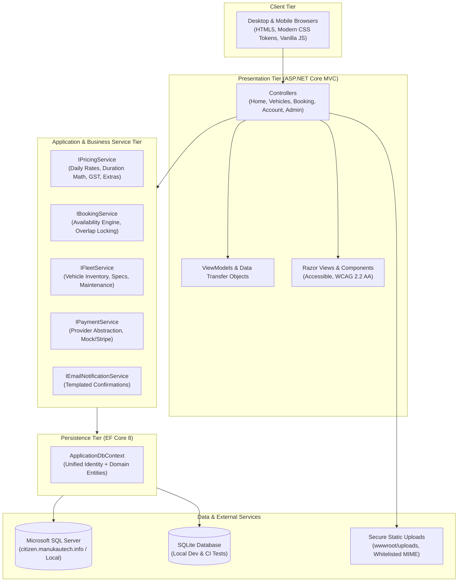
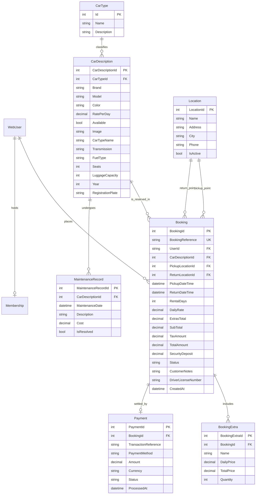

# Technical Architecture Specification — RentalCarWebsite

**System:** Commercial Automotive Rental Platform  
**Architecture Pattern:** Layered Service Architecture (ASP.NET Core MVC, Entity Framework Core)  
**Target Runtime:** .NET 8.0 LTS (C# 12)  
**Primary Database:** Microsoft SQL Server 2019/2022 / Local SQLite Fallback  

---

## 1. Architectural Overview

The application follows modern ASP.NET Core architectural principles, enforcing clean separation of concerns between presentation, domain logic, and data persistence:



---

## 2. Domain Model & Entity Relationship (ER) Design

The relational database model unifies the operational vehicle rental workflow with ASP.NET Core Identity authentication:



---

## 3. Booking Engine & Concurrency Algorithm

### 3.1 Double-Booking & Date Overlap Prevention

A vehicle is available for rental between `[RequestedPickup, RequestedReturn]` if and only if **zero active reservations** overlap with that window.

Two intervals `[A, B]` and `[X, Y]` overlap if:
$$\text{Pickup}_1 < \text{Return}_2 \quad \text{AND} \quad \text{Return}_1 > \text{Pickup}_2$$

In LINQ:
```csharp
var isUnavailable = await _context.Bookings
    .AnyAsync(b => b.CarDescriptionId == requestedCarId
        && b.Status != BookingStatus.Cancelled
        && b.PickupDateTime < requestedReturn
        && b.ReturnDateTime > requestedPickup);
```

### 3.2 Transactional Concurrency Protection

When confirming a reservation, the operation executes within an explicit database transaction with isolation level `ReadCommitted` / `Serializable` or with optimistic concurrency tokens (`RowVersion`):
1. Begin Transaction.
2. Re-verify vehicle availability using the overlap query inside the transaction.
3. If unavailable, abort transaction and return friendly user feedback.
4. If available, insert `Booking`, generate unique reference `NZR-YYYY-XXXXX`, insert associated `BookingExtras`, and save changes.
5. Commit Transaction.

---

## 4. Centralised Pricing Engine Specification

All financial calculations are performed using the C# `decimal` type to guarantee IEEE 754 precision compliance:

1. **Rental Duration:**
   $$\text{RentalDays} = \max\left(1, \left\lceil \frac{\text{ReturnDateTime} - \text{PickupDateTime}}{24\text{ hours}} \right\rceil\right)$$

2. **Base Rental Cost:**
   $$\text{BaseCost} = \text{RentalDays} \times \text{DailyRate}$$

3. **Duration Discounts:**
   - 7+ days: 10% discount on daily rate.
   - 14+ days: 15% discount on daily rate.
   - 30+ days: 20% discount on daily rate.

4. **Optional Extras:**
   $$\text{ExtrasCost} = \sum (\text{ExtraDailyPrice} \times \text{RentalDays} \times \text{Quantity})$$

5. **Subtotal & New Zealand Goods and Services Tax (GST 15%):**
   $$\text{SubTotal} = \text{DiscountedBaseCost} + \text{ExtrasCost}$$
   $$\text{GST} = \text{Round}(\text{SubTotal} \times 0.15, 2)$$
   $$\text{TotalAmount} = \text{SubTotal} + \text{GST}$$

6. **Currency:** All rates, summaries, and receipts are denominated in New Zealand Dollars (`NZD`).

---

## 5. Security & Authentication Architecture

1. **Role-Based Access Control (RBAC):**
   - `Administrator`: Full system access, user role assignments, financial logs, system configuration.
   - `Manager`: Fleet management, pricing updates, booking overrides, customer directory.
   - `Staff`: Vehicle check-in/check-out, condition reporting, customer verification.
   - `Customer`: Browse vehicles, create bookings, view personal booking history, profile management.

2. **Anti-CSRF & Data Protection:**
   - All HTTP POST actions require `[ValidateAntiForgeryToken]`.
   - Data Protection APIs used for sensitive tokens.
   - Secure cookie configuration (`HttpOnly`, `SameSite=Lax`, `SecurePolicy=Always`).

3. **Secure File Upload Pipeline:**
   - Whitelist allowed extensions: `.jpg`, `.jpeg`, `.png`, `.webp`.
   - Validate file signatures (Magic numbers).
   - Maximum upload size: 5 MB.
   - Output files stored with random GUID names to prevent directory traversal.

---

## 6. Frontend Token Architecture

The user interface uses clean CSS custom properties adhering to the *Distinctive Automotive Rental* design language:

```css
:root {
  /* Brand Palette */
  --color-primary: #0b132b;          /* Midnight Navy */
  --color-primary-light: #1c2541;    /* Slate Navy */
  --color-accent: #00a896;           /* Precision Teal */
  --color-accent-hover: #028090;     /* Deep Teal */
  --color-surface: #ffffff;          /* Pure White */
  --color-surface-subtle: #f8fafc;   /* Crisp Light Slate */
  --color-border: #e2e8f0;           /* Soft Divider */
  --color-text-main: #0f172a;        /* Deep Slate 900 */
  --color-text-muted: #64748b;       /* Neutral Slate 500 */
  
  /* Status Semantics */
  --color-success: #10b981;          /* Confirmed / Available */
  --color-warning: #f59e0b;          /* Pending */
  --color-danger: #ef4444;           /* Cancelled / Unavailable */
  --color-info: #3b82f6;             /* Active Rental */

  /* Typography */
  --font-family-sans: 'Inter', -apple-system, BlinkMacSystemFont, "Segoe UI", Roboto, sans-serif;
  --font-family-display: 'Plus Jakarta Sans', var(--font-family-sans);

  /* Shadows & Elevation */
  --shadow-sm: 0 1px 2px 0 rgba(15, 23, 42, 0.05);
  --shadow-md: 0 4px 6px -1px rgba(15, 23, 42, 0.08), 0 2px 4px -2px rgba(15, 23, 42, 0.04);
  --shadow-lg: 0 10px 15px -3px rgba(15, 23, 42, 0.08), 0 4px 6px -4px rgba(15, 23, 42, 0.03);

  /* Border Radii */
  --radius-sm: 6px;
  --radius-md: 10px;
  --radius-lg: 16px;
}
```
